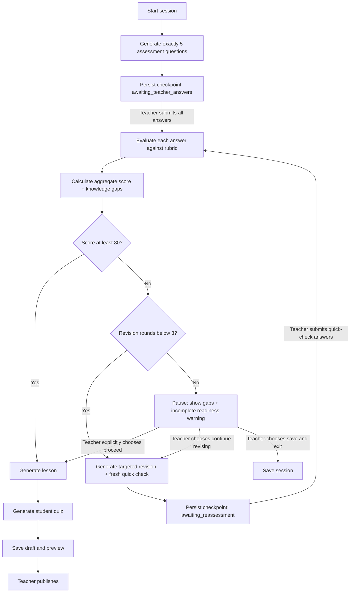

# TeachMate — Unified Product, Frontend & Backend Development Specification

**Status:** Development specification (not implemented)  
**Revision:** 2026-10-27  
**Scope:** College AI project, teacher-first agentic lesson preparation plus student learning experience.

> **Read first:** This document preserves the original backend rationale in Part I and adds authoritative frontend/product/API/workflow requirements in Part II. In case of conflict, **Part II wins**. `TeachMate_Conversation.md` is historical context only. This file is sufficient as the primary Antigravity handoff.

# PART I — ORIGINAL BACKEND ARCHITECTURE (REFERENCE)

# TeachMate – Agentic AI System for Intelligent Teaching Preparation

## 1. Project Overview

**TeachMate** is an Agentic AI-based system designed to help teachers prepare lessons intelligently.

The teacher enters a topic. TeachMate first evaluates the teacher's understanding by generating five relevant questions. It analyzes the teacher's answers, identifies knowledge gaps, and decides what should happen next.

If gaps are detected, TeachMate provides targeted revision and reassesses the teacher. If the teacher demonstrates sufficient understanding, the system proceeds to lesson generation.

The final lesson can contain:

- Learning objectives
- Storytelling
- Real-life examples
- Analogies
- Visual explanations
- Classroom activities
- Summary
- Student quiz

The important distinction from a normal AI lesson generator is:

> **TeachMate does not simply generate a lesson. It evaluates, analyzes, decides, acts, receives feedback, and adapts.**

---

# 2. Why TeachMate Is Agentic

A basic AI lesson generator looks like:

```text
Topic
  ↓
LLM
  ↓
Lesson
```

TeachMate works more like:

```text
Topic
  ↓
Assessment
  ↓
Teacher Answers
  ↓
Knowledge Analysis
  ↓
Decision
  ↓
┌─────────────────┐
│                 │
↓                 ↓
Revision         Lesson
↓                 ↓
Reassessment      Quiz
│
└──────→ Decision
```

The agentic characteristics are:

1. **State** – the system maintains information about the current teaching-preparation session.
2. **Perception** – the LLM analyzes teacher responses.
3. **Decision-making** – the system determines whether revision is necessary.
4. **Action** – the system generates revision, lessons, quizzes, etc.
5. **Feedback loop** – teacher performance after revision changes the next action.
6. **Persistence** – previous sessions, lessons, scores, and knowledge gaps can be stored.
7. **Tool usage** – future versions can use search, textbook retrieval, PDF processing, calculators, visual generation, etc.

> LangGraph is useful for implementing the workflow, but LangGraph itself does not automatically make an application agentic. The agentic behavior comes from state, decisions, actions, routing, and feedback loops.

---

# 3. Recommended High-Level Architecture

```text
                         TEACHER
                            │
                            ▼
                    React / Next.js
                            │
                       HTTP / REST
                            │
                            ▼
                    ┌───────────────┐
                    │    FastAPI    │
                    │   API Layer   │
                    └───────┬───────┘
                            │
                            ▼
                 ┌─────────────────────┐
                 │ TeachMate           │
                 │ Orchestrator        │
                 │     LangGraph       │
                 └──────────┬──────────┘
                            │
             ┌──────────────┼──────────────┐
             │              │              │
             ▼              ▼              ▼
       Assessment       Knowledge       Lesson
          Node            Node           Node
             │              │              │
             └──────────────┼──────────────┘
                            │
                       Decision Node
                            │
                 ┌──────────┴──────────┐
                 │                     │
                 ▼                     ▼
             Revision               Lesson
                 │                     │
                 ▼                     ▼
             Reassessment          Quiz Agent
                 │                     │
                 └──────────┬──────────┘
                            ▼
                        PostgreSQL
```

---

# 4. Backend Technology Stack

## Core stack

| Technology | Purpose |
|---|---|
| Python | Main backend language |
| FastAPI | REST API/backend server |
| Uvicorn | Runs FastAPI |
| Pydantic | Data validation and structured data |
| LangGraph | Agent workflow, state and routing |
| LangChain | LLM integrations/utilities where useful |
| Gemini/Groq/free-tier LLM API | AI generation and analysis |
| PostgreSQL | Persistent database |
| SQLAlchemy | Database ORM |
| Alembic | Database migrations |
| python-dotenv | Environment variables |
| Redis | Optional later for queues/rate limiting |
| pgvector | Optional later for RAG |
| PyMuPDF | Optional later for PDF/textbook processing |

---

# 5. Important Design Principle

Do **not** create five completely independent autonomous agents just to call the project multi-agent.

A better design is:

```text
                 TeachMate Agent
                       │
                   LangGraph
                       │
        ┌──────────────┼──────────────┐
        │              │              │
   Assessment       Analysis       Lesson
      Node            Node           Node
        │              │              │
        └────────── Decision ─────────┘
                       │
                    Revision
                       │
                    Quiz
```

These can be described as specialized agents/nodes while a central orchestrator controls the workflow.

This is easier to:

- Build
- Debug
- Test
- Explain
- Control
- Keep inexpensive

---

# 6. The Most Important Backend Object: State

TeachMate needs a shared state object.

Example:

```python
from typing import TypedDict, Optional

class TeachMateState(TypedDict):

    topic: str
    teacher_id: str

    questions: list
    answers: list

    score: Optional[float]
    knowledge_gaps: list
    strengths: list

    next_action: Optional[str]

    revision_content: Optional[str]
    revision_attempt: int

    lesson: Optional[dict]
    quiz: Optional[list]

    token_usage: dict
    errors: list
```

The state acts as the current working memory of the agent.

### Initial state

```python
{
    "topic": "Newton's Laws",
    "teacher_id": "teacher_123",
    "questions": [],
    "answers": [],
    "score": None,
    "knowledge_gaps": [],
    "next_action": None,
    "revision_attempt": 0
}
```

### After assessment

```python
{
    "topic": "Newton's Laws",
    "questions": [
        "...",
        "...",
        "...",
        "...",
        "..."
    ]
}
```

### After answer analysis

```python
{
    "score": 64,

    "knowledge_gaps": [
        "Newton's Second Law",
        "Force vs acceleration"
    ],

    "strengths": [
        "Newton's First Law",
        "Inertia"
    ]
}
```

### After decision

```python
{
    "next_action": "REVISION"
}
```

---

# 7. TeachMate Agents/Nodes

## 7.1 Assessment Agent

Input:

```text
Topic
Teacher level
```

Output:

```text
5 questions
```

Example prompt concept:

```text
You are the TeachMate Assessment Agent.

Generate exactly five questions to assess a teacher's
conceptual understanding of the given topic.

Include:
- Fundamental concepts
- Application
- Possible misconceptions
- Different difficulty levels

Return structured JSON.
```

---

# 8. Assessment Output

Prefer structured output rather than free-form text.

Example:

```json
{
  "questions": [
    {
      "id": 1,
      "question": "What does Newton's First Law state?",
      "concept": "Newton's First Law",
      "difficulty": "easy",
      "type": "conceptual"
    },
    {
      "id": 2,
      "question": "Why does a passenger move forward when a bus suddenly stops?",
      "concept": "Inertia",
      "difficulty": "medium",
      "type": "application"
    }
  ]
}
```

The frontend displays the questions.

---

# 9. Teacher Answers

The teacher submits answers to the backend.

Example request:

```json
{
  "topic": "Newton's Laws",
  "answers": [
    {
      "question_id": 1,
      "answer": "Newton's first law says..."
    },
    {
      "question_id": 2,
      "answer": "Because of inertia..."
    }
  ]
}
```

---

# 10. Knowledge Gap Agent

The Knowledge Gap Agent receives:

```text
Question
+
Teacher Answer
+
Expected Concept
```

The LLM evaluates the answer.

Example output:

```json
{
  "score": 72,
  "strengths": [
    "Newton's First Law",
    "Inertia"
  ],
  "knowledge_gaps": [
    {
      "concept": "Newton's Second Law",
      "severity": "moderate",
      "explanation": "The teacher understands force but has difficulty connecting force, mass and acceleration."
    }
  ]
}
```

---

# 11. Structured Output and Pydantic

Avoid asking an LLM for random text and then trying to parse it.

Use Pydantic models.

Example:

```python
from pydantic import BaseModel
from typing import List

class KnowledgeGap(BaseModel):
    concept: str
    severity: str
    explanation: str

class KnowledgeAnalysis(BaseModel):
    score: float
    strengths: List[str]
    knowledge_gaps: List[KnowledgeGap]
```

This makes the AI response predictable and easier for the backend to validate.

---

# 12. Decision Agent / Decision Node

Not every decision needs an LLM.

For example:

```python
if score >= 80:
    next_action = "LESSON"

elif score >= 50:
    next_action = "REVISION"

else:
    next_action = "DEEP_REVISION"
```

This is better than asking the LLM:

> "Should we revise?"

because simple numerical decisions are deterministic.

Recommended principle:

```text
LLM = intelligence
Python = control/business logic
LangGraph = orchestration
```

---

# 13. Preventing Infinite Revision Loops

The system must not revise forever.

Example:

```python
def decide_next_action(state):

    score = state["score"]
    attempts = state["revision_attempt"]

    if score >= 80:
        return "lesson"

    if attempts >= 3:
        return "lesson"

    return "revision"
```

Example:

```text
Score = 58%
 ↓
Revision
 ↓
Score = 67%
 ↓
Revision
 ↓
Score = 76%
 ↓
Revision
 ↓
Score = 84%
 ↓
Lesson
```

A maximum attempt count prevents infinite loops.

---

# 14. Revision Agent

The Revision Agent should receive only the relevant knowledge gaps.

Example input:

```json
{
  "topic": "Newton's Laws",
  "knowledge_gaps": [
    "Newton's Second Law",
    "Force vs acceleration"
  ],
  "teacher_level": "intermediate"
}
```

It generates targeted revision rather than explaining the entire topic.

Example:

```text
QUICK REVISION

Newton's Second Law:

F = ma

F = Force
m = Mass
a = Acceleration

Example:
A 5 kg object experiences 20 N force.

a = F/m
a = 20/5
a = 4 m/s²
```

Then it generates a quick check.

---

# 15. Reassessment

After revision:

```text
Teacher answers quick check
        ↓
Knowledge analysis
        ↓
Updated score
        ↓
Decision again
```

This creates the core agentic loop:

```text
Assess
  ↓
Analyze
  ↓
Decide
  ↓
Revise
  ↓
Reassess
  ↓
Decide
```

---

# 16. Lesson Agent

Once the teacher is ready:

```text
Topic
+
Teacher level
+
Knowledge gaps
+
Learning requirements
```

are provided to the Lesson Agent.

Example output:

```text
LESSON: Newton's Laws of Motion

1. Learning Objectives

2. Hook

3. Story

4. Concept Explanation

5. Real-world Examples

6. Visual Explanation

7. Classroom Activity

8. Summary

9. Student Quiz
```

---

# 17. Visual Explanations

For the MVP, don't immediately implement AI image generation.

Instead, ask the LLM for a visual specification.

Example:

```json
{
  "visual": {
    "type": "flowchart",
    "title": "Newton's Second Law",
    "elements": [
      "Force",
      "Mass",
      "Acceleration"
    ]
  }
}
```

The frontend can render it using:

- Mermaid
- SVG
- React Flow
- Other diagram libraries

Later, actual image generation can be added.

---

# 18. Quiz Agent

The Quiz Agent receives the generated lesson and produces student questions.

Example:

```json
{
  "quiz": [
    {
      "question": "Which law explains inertia?",
      "options": [
        "First Law",
        "Second Law",
        "Third Law",
        "None"
      ],
      "answer": "First Law"
    }
  ]
}
```

The actual quiz score should be calculated by Python, not the LLM.

---

# 19. LangGraph Workflow

Conceptually:

```text
START
  ↓
ASSESSMENT
  ↓
ANALYSIS
  ↓
DECISION
  ├───────────────┐
  ↓               ↓
REVISION         LESSON
  ↓               ↓
REASSESSMENT     QUIZ
  ↓               ↓
DECISION          END
  │
  └──→ REVISION or LESSON
```

Example setup:

```python
from langgraph.graph import StateGraph, START, END

builder = StateGraph(TeachMateState)

builder.add_node("assessment", assessment_node)
builder.add_node("analysis", analysis_node)
builder.add_node("decision", decision_node)
builder.add_node("revision", revision_node)
builder.add_node("lesson", lesson_node)
builder.add_node("quiz", quiz_node)

builder.add_edge(START, "assessment")
builder.add_edge("assessment", "analysis")
builder.add_edge("analysis", "decision")

builder.add_edge("revision", "analysis")

builder.add_edge("lesson", "quiz")
builder.add_edge("quiz", END)
```

The decision node uses conditional routing to choose revision or lesson.

---

# 20. Why LangGraph?

LangGraph is useful because the TeachMate workflow is not just a straight chain.

It contains:

- State
- Conditional routing
- Loops
- Persistence
- Retry/recovery
- Human interaction
- Multiple specialized nodes

That maps naturally to a graph.

---

# 21. LLM Strategy – Free APIs

The project will use **free-tier LLM APIs** rather than paid APIs.

Important:

> Free API does not normally mean unlimited API usage. Providers generally impose rate, token, quota, or model-specific limits. These limits can change, so the actual provider dashboard/documentation should be checked when the project is implemented.

For the MVP, use **one primary free provider** rather than immediately integrating many providers.

Possible architecture:

```text
                 TeachMate Backend
                       │
                    LLM Router
                       │
            ┌──────────┴──────────┐
            ↓                     ↓
       Primary Free API      Backup Free API
            │                     │
            └──────────┬──────────┘
                       ↓
                   LLM Response
```

A future local fallback can be added:

```text
LLM Router
    │
    ├── Free Cloud API
    │
    └── Local Model via Ollama
```

---

# 22. Recommended LLM Usage

Use the LLM for tasks that actually require language intelligence:

| Task | LLM? |
|---|---|
| Generate 5 questions | Yes |
| Evaluate teacher answers | Yes |
| Identify misconceptions | Yes |
| Identify knowledge gaps | Yes |
| Decide score threshold | No |
| Calculate quiz score | No |
| Generate revision | Yes |
| Generate lesson | Yes |
| Generate quiz | Yes |
| Store data | No |
| Authentication | No |

This reduces API usage and makes the system more reliable.

---

# 23. API Key Architecture

Never expose the LLM API key in React.

Correct architecture:

```text
React
  ↓
FastAPI
  ↓
Environment variable
  ↓
LLM Provider
```

Example `.env`:

```env
GEMINI_API_KEY=your_key_here
```

Python:

```python
import os

api_key = os.getenv("GEMINI_API_KEY")
```

The frontend should never receive this key.

---

# 24. LLM Client Layer

Keep LLM-specific code separate from the agents.

Recommended:

```text
app/
└── llm/
    ├── base.py
    ├── gemini.py
    ├── groq.py
    └── router.py
```

The agents should call something like:

```python
response = llm.generate(...)
```

instead of directly depending on a particular provider.

This allows the provider to be changed later.

---

# 25. Token Concept

LLMs process text in tokens.

A request has:

```text
Input tokens
+
Output tokens
=
Total usage
```

Example:

```text
Assessment:
Input = 1,000
Output = 400

Analysis:
Input = 1,500
Output = 350

Revision:
Input = 900
Output = 600
```

Exact tokenization depends on the model.

Token usage matters because free-tier APIs have usage limits.

---

# 26. Token Optimization

Don't send the entire TeachMate history to every agent.

Bad architecture:

```text
Every request:
Entire conversation
+
All questions
+
All answers
+
All revisions
+
Entire lesson
+
Entire database
```

Better:

### Assessment Agent

Needs:

```text
Topic
Teacher level
Assessment instructions
```

### Analysis Agent

Needs:

```text
Questions
Answers
```

### Revision Agent

Needs:

```text
Knowledge gaps
```

### Lesson Agent

Needs:

```text
Topic
Teacher level
Knowledge gaps
Learning objectives
```

### Quiz Agent

Needs:

```text
Lesson
```

This is called **context engineering**.

---

# 27. Prompt Structure

Store prompts separately.

```text
prompts/
├── assessment.txt
├── analysis.txt
├── revision.txt
├── lesson.txt
└── quiz.txt
```

Example:

```text
You are the TeachMate Assessment Agent.

OBJECTIVE:
Assess the teacher's conceptual understanding.

RULES:
1. Generate exactly 5 questions.
2. Include conceptual and application questions.
3. Avoid ambiguous questions.
4. Match the teacher's level.
5. Return structured output.
```

Then dynamically provide:

```text
Topic:
{topic}

Teacher level:
{teacher_level}
```

---

# 28. Database

Use PostgreSQL for permanent data.

Suggested tables:

```text
users
teachers
assessment_sessions
questions
answers
knowledge_analysis
revision_sessions
lessons
quizzes
quiz_attempts
agent_runs
```

## assessment_sessions

```text
id
teacher_id
topic
created_at
status
score
attempt_number
```

## questions

```text
id
assessment_id
question
concept
difficulty
type
```

## answers

```text
id
question_id
answer
score
feedback
```

## lessons

```text
id
teacher_id
topic
content
created_at
```

---

# 29. Agent State vs Database

These are different.

## LangGraph state

Temporary working memory:

```text
questions
answers
score
knowledge_gaps
next_action
revision_attempt
```

## PostgreSQL

Permanent application data:

```text
teacher
previous assessments
lessons
quiz scores
history
```

---

# 30. API Endpoints

A possible backend API:

```text
POST /api/session/start

POST /api/session/{id}/answers

GET /api/session/{id}

GET /api/session/{id}/analysis

POST /api/session/{id}/revision

GET /api/session/{id}/lesson

GET /api/session/{id}/quiz

POST /api/quiz/{id}/submit
```

For the first MVP, these can be simplified.

---

# 31. Example Complete Flow

Teacher enters:

```text
"Teach me Photosynthesis"
```

### Step 1

React:

```http
POST /api/session/start
```

Body:

```json
{
  "topic": "Photosynthesis"
}
```

### Step 2

FastAPI creates a session.

### Step 3

LangGraph starts.

```text
START
 ↓
Assessment
```

### Step 4

LLM generates five questions.

### Step 5

Teacher answers.

### Step 6

Knowledge Analyzer evaluates the answers.

Example:

```json
{
  "score": 58,
  "knowledge_gaps": [
    "Light dependent reactions",
    "Role of ATP"
  ]
}
```

### Step 7

Decision:

```text
58 < 80
```

Therefore:

```text
REVISION
```

### Step 8

Revision Agent generates targeted material.

### Step 9

Teacher completes reassessment.

```text
58%
 ↓
84%
```

### Step 10

Decision:

```text
LESSON
```

### Step 11

Lesson Agent generates the lesson.

### Step 12

Quiz Agent generates a student quiz.

### Step 13

PostgreSQL stores the session and results.

### Step 14

React displays:

```text
LESSON READY

✓ Learning Objectives
✓ Story
✓ Examples
✓ Visual Explanation
✓ Classroom Activity
✓ Quiz
```

---

# 32. Recommended Backend Folder Structure

```text
teachmate-backend/
│
├── app/
│   ├── main.py
│   │
│   ├── api/
│   │   ├── sessions.py
│   │   ├── lessons.py
│   │   └── quizzes.py
│   │
│   ├── agents/
│   │   ├── assessment.py
│   │   ├── analyzer.py
│   │   ├── revision.py
│   │   ├── lesson.py
│   │   └── quiz.py
│   │
│   ├── graph/
│   │   ├── state.py
│   │   ├── workflow.py
│   │   └── routing.py
│   │
│   ├── llm/
│   │   ├── base.py
│   │   ├── gemini.py
│   │   ├── groq.py
│   │   └── router.py
│   │
│   ├── models/
│   │   ├── user.py
│   │   ├── session.py
│   │   ├── lesson.py
│   │   └── quiz.py
│   │
│   ├── services/
│   │   ├── scoring.py
│   │   ├── retrieval.py
│   │   └── token_usage.py
│   │
│   └── database/
│       ├── connection.py
│       └── migrations/
│
├── prompts/
│   ├── assessment.txt
│   ├── analysis.txt
│   ├── revision.txt
│   ├── lesson.txt
│   └── quiz.txt
│
├── tests/
│
├── .env
├── requirements.txt
└── README.md
```

---

# 33. Libraries and Their Roles

| Library | Role |
|---|---|
| `fastapi` | API/backend |
| `uvicorn` | Server |
| `pydantic` | Validation/schema |
| `langgraph` | Agent workflow |
| `langchain` | LLM utilities/integrations |
| `google-genai` | Gemini integration if selected |
| `openai` | OpenAI integration if selected |
| `sqlalchemy` | PostgreSQL ORM |
| `psycopg` | PostgreSQL driver |
| `alembic` | Database migrations |
| `python-dotenv` | Environment variables |
| `pgvector` | Vector search later |
| `pymupdf` | PDF processing later |

---

# 34. Error Handling

The backend should handle:

- LLM timeout
- API quota/rate limit
- Invalid structured output
- Database errors
- Network errors
- Malformed user input

Basic pattern:

```python
try:
    result = call_llm()
except TimeoutError:
    retry()
```

For LLM nodes, retries and fallback providers can be added later.

---

# 35. Rate Limiting

Because free APIs have quotas, TeachMate should control requests.

Example:

```text
User
 ↓
Rate Limiter
 ↓
FastAPI
 ↓
Agent
 ↓
LLM
```

Later, Redis can be added for distributed rate limiting and job queues.

---

# 36. Security

Minimum security requirements:

```text
API keys → environment variables/secrets
Passwords → hashed
Authentication → JWT/session system
Input → Pydantic validation
Database → ORM/parameterized queries
API → rate limiting
Production → HTTPS
```

Most importantly:

> Never put an LLM API key in the frontend.

---

# 37. RAG – Future Version

A future TeachMate could allow:

```text
Teacher uploads NCERT/textbook PDF
             ↓
        PDF extraction
             ↓
           Chunking
             ↓
         Embeddings
             ↓
       Vector Database
             ↓
       Relevant chunks
             ↓
            LLM
             ↓
       Lesson generation
```

Possible stack:

```text
PyMuPDF
+
Embedding model
+
PostgreSQL + pgvector
```

This would allow the teacher to ask:

> "Create a lesson from Chapter 4 of the uploaded textbook."

---

# 38. Tool Usage – Future Version

Agents can eventually use tools such as:

```text
search_educational_content()
retrieve_teacher_history()
retrieve_textbook_content()
calculate_formula()
generate_visual()
save_lesson()
```

For example:

```text
Teacher:
"Prepare a lesson using current information."

Agent:
I need current information.
       ↓
Web Search Tool
       ↓
Search Results
       ↓
LLM
       ↓
Lesson
```

This makes the agent more capable.

---

# 39. Teacher Memory – Future Version

Store:

```text
Teacher
 ├── Topics taught
 ├── Previous assessments
 ├── Knowledge gaps
 ├── Generated lessons
 └── Quiz performance
```

Then TeachMate can adapt future lesson preparation based on previous sessions.

---

# 40. Token Usage Tracking

Create an `agent_runs` table:

```text
agent_name
model
input_tokens
output_tokens
total_tokens
latency
timestamp
session_id
```

Example:

```text
Session #82A91

Assessment
Input: 1,100
Output: 420

Analysis
Input: 1,800
Output: 350

Revision
Input: 900
Output: 700

Lesson
Input: 1,500
Output: 2,400

Quiz
Input: 2,000
Output: 700
```

This allows you to measure how much AI usage one TeachMate session consumes.

---

# 41. Development Roadmap

## Phase 1 – Backend Foundation

Build:

```text
FastAPI
+
PostgreSQL
+
Pydantic
```

Create basic session APIs.

---

## Phase 2 – First LLM Integration

Implement:

```text
Topic
 ↓
Assessment Agent
 ↓
5 questions
```

Do not build the complete agent system immediately.

---

## Phase 3 – Answer Analysis

Implement:

```text
Questions + Answers
 ↓
LLM
 ↓
KnowledgeAnalysis
```

---

## Phase 4 – Decision Engine

Implement:

```python
if score >= 80:
    lesson()
else:
    revision()
```

---

## Phase 5 – LangGraph

Convert the workflow to:

```text
Assessment
 ↓
Analysis
 ↓
Decision
 ↓
Revision
 ↓
Analysis
 ↓
Lesson
 ↓
Quiz
```

---

## Phase 6 – Database Persistence

Store:

- Sessions
- Questions
- Answers
- Scores
- Knowledge gaps
- Lessons
- Quizzes
- Token usage

---

## Phase 7 – Frontend

Connect:

```text
React
 ↓
FastAPI
 ↓
LangGraph
 ↓
LLM
 ↓
PostgreSQL
 ↓
React
```

---

## Phase 8 – Advanced Features

Add later:

- RAG
- PDF upload
- Teacher memory
- Web search
- Visual generation
- Voice
- Student analytics
- Multiple LLM providers
- Local LLM fallback

---

# 42. Recommended MVP

Do not initially build:

- Multiple LLM providers
- Complex RAG
- Voice
- Image generation
- 10 autonomous agents
- Advanced analytics

Build:

```text
             TEACHMATE MVP

React
  ↓
FastAPI
  ↓
LangGraph
  ↓
Free LLM API
  ↓
PostgreSQL

Assessment
    ↓
Analysis
    ↓
Decision
    ↓
Revision ↺
    ↓
Lesson
    ↓
Quiz
```

This is enough to demonstrate the core innovation.

---

# 43. Final Mental Model

Remember these roles:

```text
LLM
= Intelligence

Python
= Business logic/control

LangGraph
= Agent orchestration + state workflow

FastAPI
= Communication/API layer

PostgreSQL
= Permanent memory/data

RAG/tools
= External knowledge and actions

React
= User interface
```

The key architecture is:

```text
                    LLM
                     │
              "What does this mean?"
                     │
                     ▼
                ┌───────────┐
                │   STATE   │
                └─────┬─────┘
                      │
                      ▼
                  DECISION
                      │
             ┌────────┴────────┐
             │                 │
          REVISION            LESSON
             │                 │
             └────────┐ ┌──────┘
                      ▼ ▼
                    FEEDBACK
                      │
                      ▼
                    STATE
                      │
                      ↺
```

**TeachMate is agentic because it can evaluate the current situation, choose an appropriate action, execute that action, receive new information, update its state, and adapt its next action.**

---

# 44. Suggested Project Tagline

> **TeachMate – An Agentic AI Teaching Assistant that Understands, Adapts, and Prepares.**

Alternative:

> **TeachMate – From Teacher Assessment to Adaptive Lesson Preparation.**

---

# PART II — IMPLEMENTATION CONTRACT (AUTHORITATIVE, 2026-10-27)

> **Precedence:** This Part II supersedes any conflicting examples, suggested endpoints, flowcharts, thresholds, and implementation shortcuts in Part I and in `TeachMate_Conversation.md`. Part I remains background explanation, not executable specification. No functionality in this document is claimed to be implemented yet.

## 45. Product scope and role boundaries

**Primary persona:** teacher preparing a classroom lesson. **Secondary persona:** student consuming teacher-published micro-lessons and attempting quizzes. Do not accidentally turn TeachMate into a generic course marketplace. Course discovery, learner streaks, and scroll-learning are supporting features connected to teacher-created lessons.

**MVP (must ship):** teacher sign-in, topic + subject + grade/level + lesson duration entry, exactly five assessment questions, free-text answer submission, rubric-based AI evaluation, strengths/gaps with evidence, adaptive decision, revision with quick checks, manual resume/reassess, up to three revision rounds, explicit teacher choice after limit, classroom-ready lesson, diagram specifications rendered safely, five-question student quiz, teacher preview/publish, student lesson browse/scroll/quiz, persisted progress, basic streaks and earned badges, light/dark accessible UI, API error/loading/retry states.

**Phase 2 (NOT promised in MVP):** AI-generated videos, third-party short-video import, textbook RAG/PDF uploads, advanced student analytics, push notifications, teacher long-term personalized memory, classroom management, multi-provider failover, TTS. MVP scroll cards can show short text, illustrations/diagrams and **optional teacher-uploaded or embedded captioned videos**, but must not advertise AI video generation. Upload/storage may be deferred: if so use lesson cards with no video and an honest empty state.

**Acceptance principle:** Any feature shown in product UI must be backed by an actual endpoint and persisted state; no fake score, fake badges, hard-coded progress or fake video thumbnails presented as real content.

## 46. Definitive agentic workflow and human-in-the-loop control



**Implementation constraints:** Use LangGraph with durable checkpointer; `thread_id` = session UUID and authenticated user ownership verified on every resume. Node execution **ends/interrupts** at `awaiting_teacher_answers`, `awaiting_reassessment`, or `awaiting_teacher_choice`; never run `analysis` before relevant answers exist. FastAPI persists the question set before pausing, then accepts answer payload and resumes the graph using a supported `interrupt`/`Command(resume=...)` pattern (or equivalent documented persistent human-in-loop approach). Persist state on each transition and avoid duplicating LLM calls after retries. Database rows hold durable business records; LangGraph checkpoints hold execution state. Reconcile status if recovery restarts mid-request.

**Revision rounds:** `revision_rounds_completed` starts at 0. Thresholds: >=80 ready; 50–79 targeted revision; <50 detailed revision. These are initial configurable product rules, not psychometrically validated standards. Limit automatic rounds to 3; **never silently mark a sub-80 teacher as ready**. At the limit show current score, remaining gaps, disclaimer that readiness is incomplete, and actions `Proceed anyway`, `Continue revision`, `Save for later`. `Proceed anyway` records an explicit override with timestamp and resulting lesson carries `readiness_override: true`. Allow voluntary early skip with same acknowledgement. Each reassessment uses new questions focused on the gaps; include enough evidence to evaluate improvement. If a teacher answers fewer than required questions, return validation error without advancing.

**Rubric:** Each question has `id`, `concept`, `difficulty`, `type`, `rubric_criteria` and optionally `reference_explanation` stored server-side. AI output includes per-question 0–100 score, criterion-level feedback, misconception(s), confidence note, and evidence quoted/paraphrased from supplied answer. Python validates range and computes aggregate score (equal weighting for MVP); Python chooses branch. Display scores as AI-generated estimates, not objective certifications. Instructor can inspect feedback. Exclude reference answers from initial assessment response to prevent answer leakage.

## 47. Architecture, provider choice and runtime behavior

- **Client:** TypeScript React + Vite + Tailwind CSS; React Router, accessible headless components, TanStack Query for remote state. A Next.js implementation is acceptable only if deliberately selected **instead** of Vite; do not create both.
- **API:** Python FastAPI, Pydantic v2, SQLAlchemy 2, Alembic, PostgreSQL, LangGraph. JWT or secure server-side session cookie; for MVP choose secure HTTP-only cookie auth and CSRF protection for state-changing requests. CORS restrict to configured frontend origins.
- **Primary AI:** **Gemini via `google-genai`** as the single MVP cloud provider, with a specific available model configured via `GEMINI_MODEL` and confirmed against current provider docs/account at implementation time. Do not assume an exact model name, stable free-tier eligibility or quota. Groq/Ollama are *future optional* adapters, not an implicit failover.
- **Secrets:** `GEMINI_API_KEY`, `DATABASE_URL`, `SESSION_SECRET`, `CORS_ORIGINS`, `GEMINI_MODEL`, request/token ceilings, timeout settings; `.env.example` contains placeholders, `.env` ignored by git. All provider calls server-side.
- **Safety/reliability:** request timeout; at most two retries for transient errors with exponential backoff and jitter honoring provider retry hints; never retry authentication/validation errors. Per-user and global rate limits; token and daily usage caps. Quota exceeded => structured `AI_QUOTA_EXCEEDED` error and preserve paused session, with retry later. Invalid structured JSON => one targeted repair/retry; then structured provider error, never made-up content. Cache or store completed generated node results with stable IDs to avoid accidental duplicate charges. Log correlation IDs, durations and token counts; do not log raw teacher answers or API keys by default.
- **Accessibility/security:** audit for prompt injection in untrusted submitted content; no direct user data as system instructions; sanitize markdown/HTML/diagram specs; diagram renderer allowlist; validate payload sizes and ownership; prepare deletion/export endpoints and privacy notice before collecting student data.

## 48. Canonical API contract (`/api/v1`)

All requests/responses use JSON unless specified. Dates UTC ISO 8601, IDs UUID strings, score 0–100, predictable `status` enum. Auth cookie required except registration/login and public published-catalog endpoints. Repeated state-changing calls require idempotency key where indicated.

**Consistent error envelope:**
```json
{"error":{"code":"VALIDATION_ERROR","message":"Answers are incomplete.","details":{"missing_question_ids":["uuid"]},"request_id":"uuid"}}
```
HTTP guidance: `400` malformed business request, `401` unauthenticated, `403` forbidden, `404` unknown/not owned resource (prefer 404 on ownership ambiguity), `409` incorrect session state/duplicate incompatible transition, `422` schema validation, `429` user/provider rate limit or quota, `502` upstream malformed/failure, `503` temporary provider unavailable, `504` timeout, `500` unexpected exception. FastAPI's default validation response should be normalized if using this envelope.

| Method/path | Request (essential fields) | Success response | Status/notes |
|---|---|---|---|
| `POST /auth/register` | `{email,password,display_name,role}` | `{user:{id,role,...}}` | `201`; role teacher or student, no elevated role via request |
| `POST /auth/login` | `{email,password}` | `{user:{id,role,...}}` + HTTP-only cookie | `200`; throttle |
| `POST /auth/logout` | `{}` | `{ok:true}` | `200` |
| `GET /me` | — | `{user:{id,role,display_name}}` | `200` |
| `POST /sessions` | `{topic,subject,grade_level,duration_minutes}` | `{session_id,status:"generating_assessment"}` | `202`, `Idempotency-Key` required; async generation begins |
| `GET /sessions/{id}` | — | `{id,status,topic,score,revision_rounds_completed,readiness_override,updated_at}` | `200` |
| `GET /sessions/{id}/assessment` | — | `{questions:[{id,question,concept,difficulty,type}],status:"awaiting_teacher_answers"}` | `200`, only when ready |
| `POST /sessions/{id}/answers` | `{answers:[{question_id,text}],expected_version}` | `{status:"analyzing",session_id}` | `202`; all five distinct IDs required; version+idempotency guard |
| `GET /sessions/{id}/analysis` | — | `{score,strengths,gaps:[{concept,severity,explanation}],per_question_feedback:[...],next_action}` | `200`; status-specific `409` before available |
| `GET /sessions/{id}/revision` | — | `{round,content,quick_check_questions:[{id,prompt,concept}],status}` | `200`; omit answer key |
| `POST /sessions/{id}/reassessment` | `{answers:[{question_id,text}],expected_version}` | `{status:"analyzing",session_id}` | `202`; validates current quick check and persists before graph resume |
| `POST /sessions/{id}/decision` | `{action:"proceed_anyway"\|"continue_revision"\|"save_for_later",acknowledge_incomplete_readiness:true,expected_version}` | `{status,readiness_override}` | `200/202`; only allowed in `awaiting_teacher_choice`; acknowledgment required to proceed |
| `GET /sessions/{id}/lesson` | — | `{lesson:{id,title,objectives,sections:[...],visual_specs:[...],activities:[...],summary},readiness_override}` | `200` when created |
| `POST /sessions/{id}/publish` | `{expected_version}` | `{lesson_id,visibility:"published"}` | `200`; teacher owner only, reject unfinished lesson |
| `GET /lessons` | `?subject=&grade_level=&q=&cursor=` | `{items:[...],next_cursor}` | `200`; only published catalog for students |
| `GET /lessons/{id}` | — | `{lesson:{...},micro_lessons:[...],quiz_available:true}` | `200`; draft visible only to owner |
| `POST /lessons/{id}/progress` | `{card_id,completed:true,expected_version}` | `{completed_cards,total_cards,progress_percent,streak}` | `200`; idempotent marking; server computed |
| `GET /me/progress` | — | `{courses:[...],streak:{current,longest},badges:[...]}` | `200` |
| `GET /lessons/{id}/quiz` | — | `{quiz_id,questions:[{id,text,options}]}` | `200`; **never include correct answers** |
| `POST /quizzes/{id}/attempts` | `{answers:[{question_id,selected_option_id}]}` | `{score,correct_count,total,feedback,earned_badges}` | `201`; Python grades against private answer key |

**Polling and background execution:** For MVP use async worker/task with durable status where feasible; long LLM calls must not block browser request indefinitely. Client polls current session at 1–2 second intervals while generating, with backoff. Status values: `generating_assessment`, `awaiting_teacher_answers`, `analyzing`, `awaiting_reassessment`, `awaiting_teacher_choice`, `generating_lesson`, `draft_ready`, `published`, `failed`, `saved`. Return 202 for queued actions; 409 for invalid transitions; preserve resumability. For deployment requiring durable asynchronous jobs, use a persistent job queue/worker rather than only in-process FastAPI background tasks.

**Contract details to implement before shipping:** Full Pydantic request/response models (IDs, string limits, enums, versioning), migrations, auth policies, ownership checks, pagination limits, audit timestamps, and OpenAPI examples. The table is normative for routes/shape, not a substitute for explicit Pydantic definitions.

## 49. Database and consistency requirements

Minimum models: `users`, `sessions`, `assessment_questions`, `assessment_answers`, `knowledge_analyses`, `revision_rounds`, `reassessment_questions`, `reassessment_answers`, `lessons`, `micro_lesson_cards`, `quizzes`, `quiz_questions`, `quiz_attempts`, `lesson_progress`, `badge_definitions`, `user_badges`, `user_daily_activity`, `agent_runs`, plus durable LangGraph checkpointer storage. Every user-scoped row enforces foreign keys and authorization; unique `(user_id,card_id)` progress; unique `(user_id,badge_id)` badges; indexed `(user_id,created_at)` session listing and `(lesson_id,position)` ordering. Use session `version` integer for optimistic concurrency.

Quiz solutions remain server-side, never included in learner quiz GET response. Draft lessons hidden from student catalog until published. Define soft-delete/deletion behavior for user personal records; student name/email and teacher answers are treated as private data.

## 50. Frontend specification: professional minimal learning platform

### 50.1 Visual design tokens (strict)

Apply **60/30/10 as a visual composition guide**, not a requirement for exact pixel accounting:

| Role | Color | HEX | Use |
|---|---|---|---|
| 60% foundation | Warm off-white | `#F5F3ED` | Main background, breathable page canvas |
| 30% structure | Forest green | `#203F36` | Headings, navigation, data hierarchy, dividers and substantial side panels |
| 10% accent | Muted warm coral | `#C7664F` | Primary CTAs, important progress milestones, active selections |
| Supporting surface | Warm pale cream | `#EBE8DF` | Card backgrounds, secondary panels |
| Supporting text | Deep slate-green | `#30483F` | Body copy |
| Supporting border | Muted gray-green | `#C4CBC4` | Outlines, separators |
| Success | Deep teal-green | `#226849` | Completed milestones and confirmations |
| Warning | Dark ochre | `#795716` | Revision/readiness warnings |
| Danger | Dark brick | `#A63F37` | Input errors |

**Strict prohibitions:** no pure `#000000`, no pure `#FFFFFF`, no purple-to-blue gradient, no neon, no glowing drop shadows, no gratuitous glassmorphism, no animated backgrounds. Flat opaque cards, subtle 1px borders, restrained shadows (`0 2px 8px rgba(32,63,54,.07)` maximum), generous whitespace, rounded corners 10–16px. No gradients anywhere by default. For button text, test WCAG ratios; choose deep dark text over coral where needed to satisfy contrast rather than using off-white blindly. Use teal/ochre status alongside labels/icons, never color alone.

**Dark mode:** foundation `#192A25`, raised surface `#25372F`, body text `#F0EEE5` (not pure white), muted text `#C9D2C8`, coral action `#E28B75` with dark readable text. Dark mode must be genuinely high contrast, not an inversion filter. User-visible toggle with persisted preference, respects OS preference on first visit. Document contrast verification: body text >=4.5:1; large text >=3:1; UI component boundaries/focus indicators >=3:1 where WCAG 2.2 AA applies.

**Typography:** `Inter` or `Manrope` (fallback `system-ui`), 16px base, 1.5–1.65 line-height, 32–40px page heading, 20–24px card headings, max 70–75 character reading width. Use tabular numerals for scores. Avoid tiny labels below 12–13px. Icons from a consistent set (Lucide), always with accessible names for interactive controls.

### 50.2 Information architecture and navigation

Teacher desktop shell: persistent left sidebar or compact top bar with `Dashboard`, `New Lesson`, `My Lessons`, `Assessments`, `Progress`, `Settings`, and profile/sign-out. Student shell: `Explore`, `My Learning`, `Progress`, `Badges`, `Settings`. Tablet/mobile: responsive top bar + accessible bottom navigation (max 4 primary items, overflow in menu). Breadcrumbs on nested pages; clear active nav marker; global back/close; search and filters for published catalog. Separate teacher vs student experiences cleanly, never display student quiz answer keys.

### 50.3 Screens / routes

| Route | Role | Required UX |
|---|---|---|
| `/` | All | Minimal welcoming landing, concise TeachMate USP, sign in/up, sample workflow |
| `/login`, `/register` | All | Validated forms, password visibility, helpful errors, accessible focus |
| `/teacher/dashboard` | Teacher | Resume session CTA, recent lesson drafts, last assessment result, overview stats |
| `/teacher/new` | Teacher | Topic, subject, grade, duration, `Start Assessment` CTA, realistic loading |
| `/teacher/sessions/:id/assessment` | Teacher | Five questions, step counter + progress bar, saved answer draft, previous/next, submit review |
| `/teacher/sessions/:id/analysis` | Teacher | Overall AI-estimated score, concept strengths, gap cards, reasoning, next action |
| `/teacher/sessions/:id/revision` | Teacher | Bite-sized revision cards, quick-check answer fields, round tracker, resubmit |
| `/teacher/sessions/:id/decision` | Teacher | Score below threshold, remaining gaps, clear choices/acknowledgment, save option |
| `/teacher/sessions/:id/lesson` | Teacher | Editable structured lesson preview, visual diagrams, objectives, activities, quiz preview, publish |
| `/teacher/lessons` | Teacher | Draft/published listing, resume, search, filters |
| `/student/explore` | Student | Course/topic discovery, search/filter by subject/grade, cards with meaningful metadata |
| `/student/lessons/:id` | Student | Vertical scroll-learning card stack, lesson overview, micro-lessons, quiz CTA |
| `/student/progress` | Student | Per-lesson completion, weekly activity, streak, badges, recent quiz scores |
| `/student/badges` | Student | Earned/locked badges, transparent award criteria, no fabricated rewards |
| `/settings` | Both | Account, light/dark/system theme, reduced motion, accessibility options |

Editing existing lesson: allow user to edit text and objectives locally and save via a dedicated authenticated PATCH endpoint to be added before enabling edit UI. **Do not show a functional-looking edit/save button without implementing persistence.**

### 50.4 Scroll-learning UI (bitesized, not addictive)

Student lesson uses vertically stacked, swipe/scroll-friendly cards with one focused learning objective each. Card types: `concept`, `example`, `diagram`, `micro_quiz`, `reflection`, `video` (only when real user-provided source exists). Show section index, estimated reading time, progress, transcript/captions when video exists, `Previous`, `Next`, `Mark Complete`, `Save for Later`, and `Go to Full Lesson`/`Take Quiz` as appropriate. Allow keyboard arrow navigation with visible focus, mouse-wheel/trackpad and touch swipe; **never trap scrolling**, force autoplay, infinite scrolling, or surprise audio. Disable autoplay by default; no infinite feed; finite card count with accessible end-of-lesson summary. Completion is explicit or based on an unambiguous action, not merely scroll position. Provide regular page layout fallback for reduced-motion/assistive technologies.

### 50.5 Gamification (supportive and evidence-based)

- **Progress bars:** `completed_cards / total_cards` (server-calculated percent, clamped 0–100) and step progress during assessments. Visible numeric text + accessible label (`3 of 8 cards completed`), never color-only.
- **Streaks:** increment on a unique local calendar date with meaningful completed lesson card or quiz attempt (not merely logging in); at most once per date, computed server-side using each user's configured IANA timezone (default `Asia/Kolkata` until user changes); allow one missed day without resetting *only if product explicitly adopts a grace-day rule*—MVP defaults **no grace day** for simplicity. Surface timezone/date rules; avoid shame-based messages.
- **Badges:** `First Lesson` (complete first published lesson), `Consistent Learner` (3 consecutive active days), `Quiz Explorer` (submit 5 distinct quiz attempts), `Lesson Finisher` (complete 5 lessons). Awards are computed on backend within transaction with unique constraints; badge titles, descriptions and qualifying criteria are displayed. No fake achievement history.
- **Motivation:** gentle celebratory micro-interaction when earned, disabled for `prefers-reduced-motion`; no leaderboards, competitive rankings or streak pressure in MVP.
- **Teacher:** show non-gamified session-readiness progress separately from student learning streaks to avoid mixing different meanings of progress.

### 50.6 Accessibility (WCAG 2.2 AA target)

Semantic landmarks and heading order, skip-to-content link, descriptive link/button names, native accessible form controls, keyboard-only operation including scroll-learning, obvious `:focus-visible` ring, minimum contrast requirements above, ARIA live regions for background generation status and errors (avoid noisy repeated announcements), error summary linking to inputs, no reliance on color/icons alone, screen-reader accessible chart/table alternatives, captions and transcripts for every video, alt text for substantive diagrams and textual graph descriptions, touch targets around 24x24 CSS px minimum with practical preference >=44x44, and responsive support at 320 CSS px / 200% zoom. Test with VoiceOver and NVDA where available. Respect reduced motion; animations <=200ms and nonessential only.

### 50.7 Interaction states and responsive behavior

Every data-driven page handles: initial skeleton/loading with status label, successful data, empty state with meaningful CTA, recoverable error with retry, nonrecoverable failure, offline/network loss, quota exceeded, permission denied, long-running generation, resume-after-refresh, and save confirmation. Disable duplicate submissions while active; session version conflicts show refresh/restore choice. Desktop layout uses grid with reading column; mobile collapses to single column, large tap controls and no horizontal scroll. Modals are keyboard trapped **only while open**, close on Escape, restore focus. Use real course data, never placeholder cards shown as actual courses after launch.

## 51. Development phases and definition of done

1. **Foundation:** choose Vite React TS + FastAPI; configure PostgreSQL, Alembic, authentication/roles, environment, CI/lint/typecheck. **Done:** health endpoint, migration, login/logout, role guards and protected route tests work.
2. **Assessment:** generate exactly five questions with provider structured output, persist questions and paused graph, submit free-text answers and rubric evaluation. **Done:** refresh mid-assessment doesn't lose state, no model key reaches browser, score and feedback trace back to responses.
3. **Agentic revision:** implement branching, targeted micro-lessons and reassessment, three-round cap, explicit teacher override, durable interrupt/resume. **Done:** high-score and low-score demo paths both work; no auto-pass after three rounds; reload/retry no duplicate transitions.
4. **Lesson + quiz:** create detailed editable draft only when edit API exists, render safe diagrams, generate quiz, hide correct answers, publish, student submit and Python grading. **Done:** published lesson visible in browse; draft hidden; quiz answers stay server-side.
5. **Frontend + gamification:** complete screen set, scroll-card UX, real progress, streaks, badges, theme and accessibility. **Done:** server-backed activities reflected correctly after reload, keyboard navigation works, accessible labels and contrast pass.
6. **Release hardening:** test quotas, provider failures, concurrency, auth/ownership, error envelopes, pagination, data deletion, deployment, reproducible demo fixtures. **Done:** all acceptance criteria below pass; README setup plus demo steps verified on clean environment.

### 51.1 Mandatory tests

- **Unit:** weighted rubric aggregation rules (equal weighting MVP), thresholds at 49/50/79/80, max rounds, override, streak boundary dates/timezones, badge idempotency, quiz scoring.
- **API integration:** schema validation, role/ownership, duplicate answer IDs, submitting prior questions, version conflicts, missing keys, unsupported statuses, publish draft, answer-key secrecy, pagination.
- **LLM contracts:** mock provider returning valid/invalid schema, timeout, 429, quota, partial output, unexpected markup; repair once then clean error.
- **Workflow:** start → pause → resume; concurrent answer submissions; crash/restart → checkpoint recovery; 85% direct lesson; 55% revision → 82% lesson; 35% → three failed rounds → choice, not forced pass.
- **End-to-end browser:** teacher full journey; student browse → card completion → quiz → badge; refreshing sessions; mobile 320px, light/dark, keyboard-only navigation, screen-reader announcements, video captions only if video enabled.
- **Security:** no secrets in frontend bundle/logs, horizontal ID access denied, rate limits, CSRF/session-cookie policy, prompt injection isolation, HTML and diagram sanitization.

### 51.2 Demo scenarios

**High readiness:** enter `Newton's Laws` → five questions → submit strong answers → AI-estimated score >=80 → generate a 40-minute lesson → preview → publish → student quiz. **Low readiness:** weak answers → gaps → revision quick checks → three rounds with score <80 → warning and explicit teacher decision, then lesson is flagged if overridden. **Student:** open published lesson, navigate micro-cards, mark completion, observe persisted progress, submit quiz, earn legitimate badge.

## 52. Antigravity handoff protocol

Read this **single updated file** first. Treat Part II as binding over Part I when conflicts exist; use `TeachMate_Conversation.md` only for additional context, not as a second source of competing instructions. **First deliver** requirements audit, ADR decisions, ERD, LangGraph interruption/resumption state chart, OpenAPI/Pydantic schema draft, visual design tokens, frontend sitemap and phased task plan. **Then implement phase-by-phase**, with real tests and results; stop to ask only for essential external secrets/credentials or truly blocking product choices. Maintain a checklist in `IMPLEMENTATION_PLAN.md`, document deviations, do not invent working features, and do not mark a phase done unless its acceptance criteria pass.
